# Zo werkt NEXUS OS nu (25 november 2026)

NEXUS OS is een persoonlijk besturingssysteem van Ethan Allains (student Elektronica-ICT). Het draait
in de browser als installeerbare PWA, als Windows- en Linux-app (Tauri), als Android-companion met
een Wear OS-horloge-app, en als eigen Linux-distro. Alles werkt lokaal eerst (offline) en synct via
Supabase. Deze pagina beschrijft in tekst en beelden hoe het er vandaag uitziet, zodat iemand die
NEXUS niet kan openen (zoals een AI-assistent) toch weet waar het om gaat.

Code: deze repository (`apps/web` voor de webdesktop, `packages/core` voor de logica). Opgebouwd met
React 19, TypeScript, Vite, Tailwind 4, Vitest en Playwright. De beelden hieronder komen uit een
rondleiding van een minuut, opgenomen met voorbeeldgegevens.

## Omvang

- Meer dan 40 apps in één vensteromgeving: Agenda, Notities, Studie, Cijfers, Gewoontes,
  Leerkaarten, Herinneringen, Bestanden, NEXUS AI, Flow Studio (automatisering), Inbox, Spaces,
  Time Machine, Bridge, Teams, Vrienden, Darts, Gaming Companion, Weer, Rekenmachine en meer.
- Vier profielen (School, Persoonlijk, Gaming, Developer), elk met eigen apps, dashboard en thema.
  Ze wisselen automatisch op een schema of met de hand.
- Twee thema's: **Focus** (licht, groen) en **Pulse** (donker, koper), samen het "Werkbank"-ontwerp:
  een breadboard-raster als achtergrond en koperen sporen met een soldeerpunt voor wat actief is.
- Ongeveer 840 bestanden, 84 000 regels TypeScript, 50 databasemigraties met row-level security.

## De rondleiding

### 1. Het bureaublad
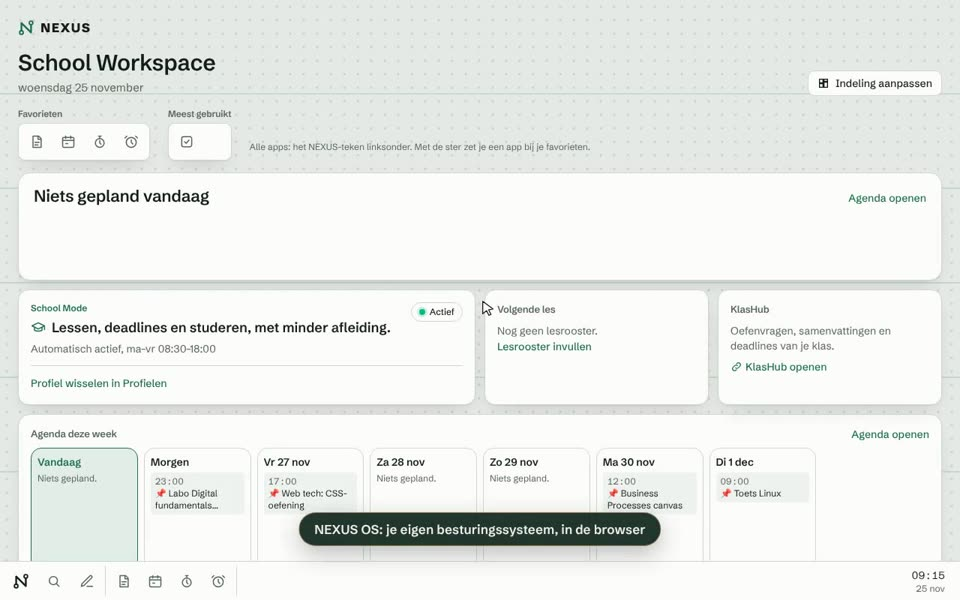
Bovenaan het NEXUS-teken (een N als koperspoor tussen twee soldeerpunten), de naam van het
profiel en de datum. Daaronder je **favorieten** en de apps die je het **meest gebruikt**. Het
dashboard vult het scherm met widgets die je zelf indeelt: wat vandaag gepland staat, het actieve
profiel, je volgende les, KlasHub en je agenda van de week. Onderaan de taakbalk met het
NEXUS-teken (Start), zoeken, snel vastleggen, je favoriete apps en rechts de klok.

### 2. Je dag in één blik
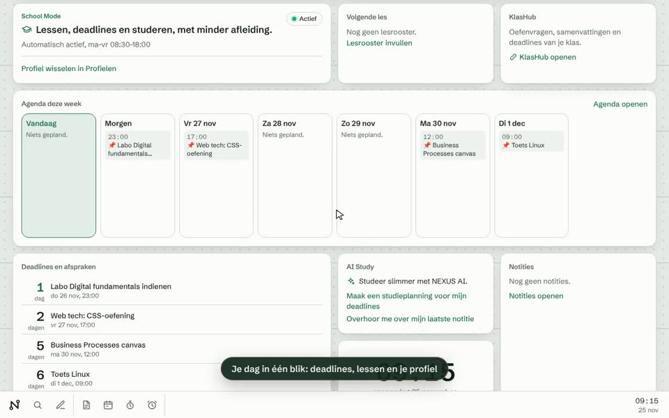
De weekagenda toont deadlines en afspraken per dag; daaronder de deadlines met het aantal dagen
dat nog rest, NEXUS AI als studiehulp en je laatste notities.

### 3. Alle apps onder het NEXUS-teken
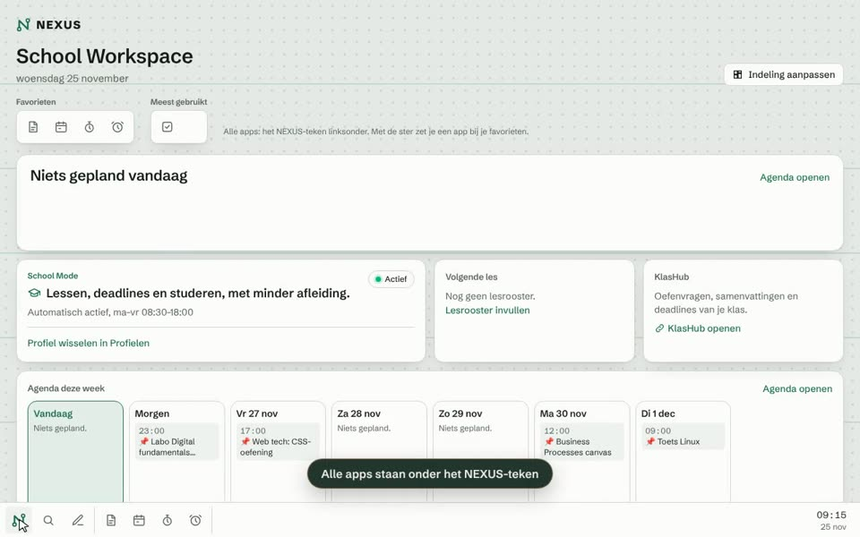
Het NEXUS-teken linksonder is het Start-menu met alle apps en een zoekveld bovenaan.

### 4. Een favoriet maken
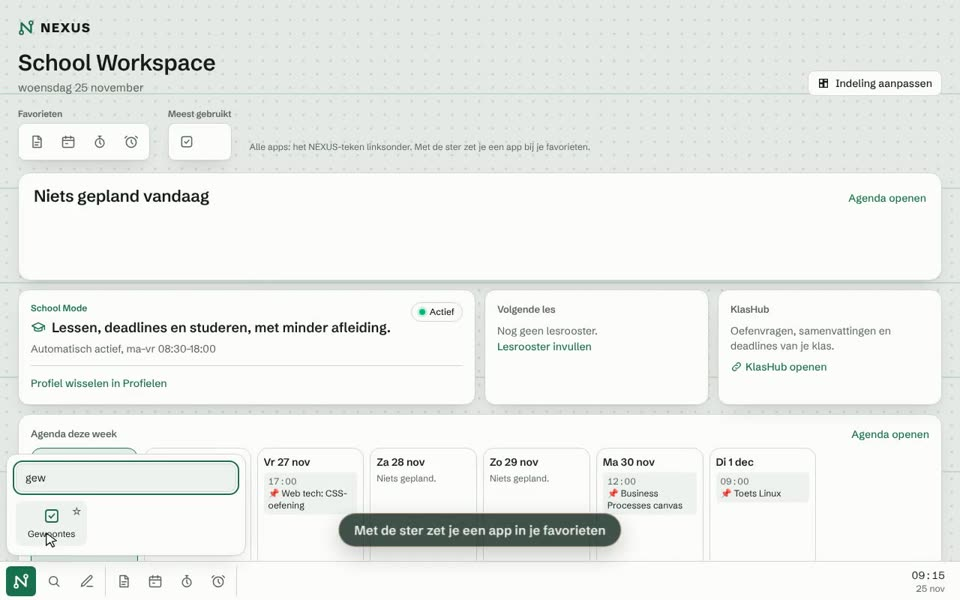
Met de ster bij een app zet je hem bij je favorieten; hij staat dan meteen in de taakbalk en op
het bureaublad. Een app die open staat krijgt een punt eronder.

### 5. Gewoontes
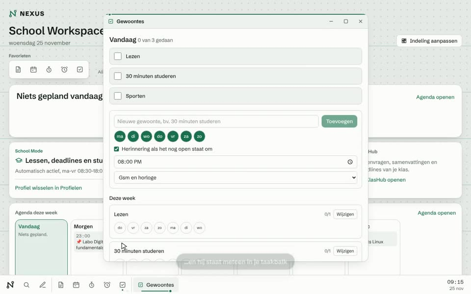
Gewoontes afvinken met een reeks (het vlammetje), per weekdag, met een herinnering naar gsm en
horloge als iets nog open staat.

### 6. Vensters
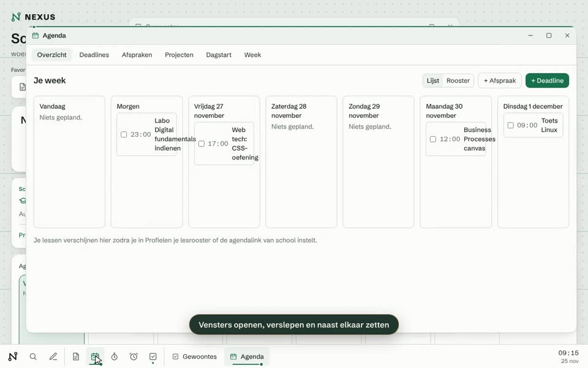
Apps openen als vensters die je versleept, maximaliseert, minimaliseert of tegen de rand van het
scherm vastzet. Vensters komen zacht binnen; de bovenrand van het venster vooraan is een koperspoor.
Open vensters staan als knoppen in de taakbalk.

### 7. Zoeken met Ctrl+K
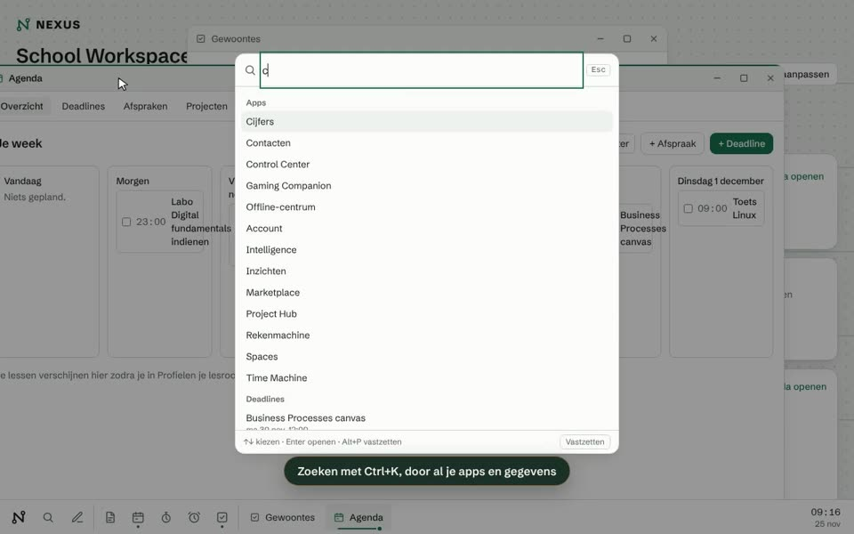
Eén zoekveld voor apps en je gegevens (zoals deadlines), volledig met het toetsenbord te bedienen.

### 8. Cijfers en het Start-menu
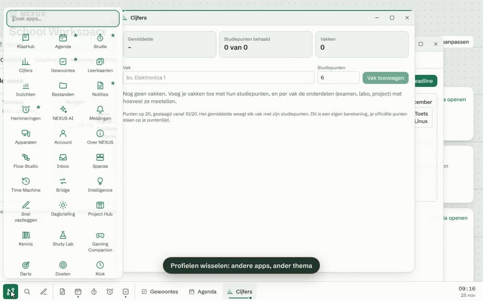
Links het Start-menu met alle apps (sterren bij de favorieten), rechts Cijfers: vakken met
studiepunten, en wat je op je volgende examen moet halen.

### 9. Profielen en Pulse
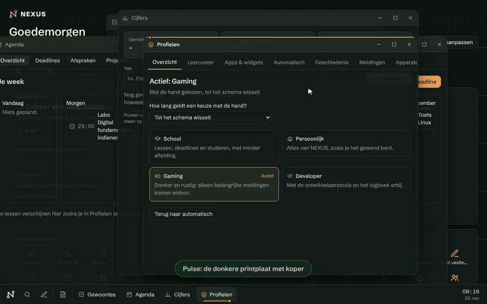
In Profielen kies je een profiel met de hand. Gaming gebruikt **Pulse**: een donkergroene
printplaat met koperen accenten. Het dashboard verandert mee ("Goedemorgen").

### 10. Op de gsm
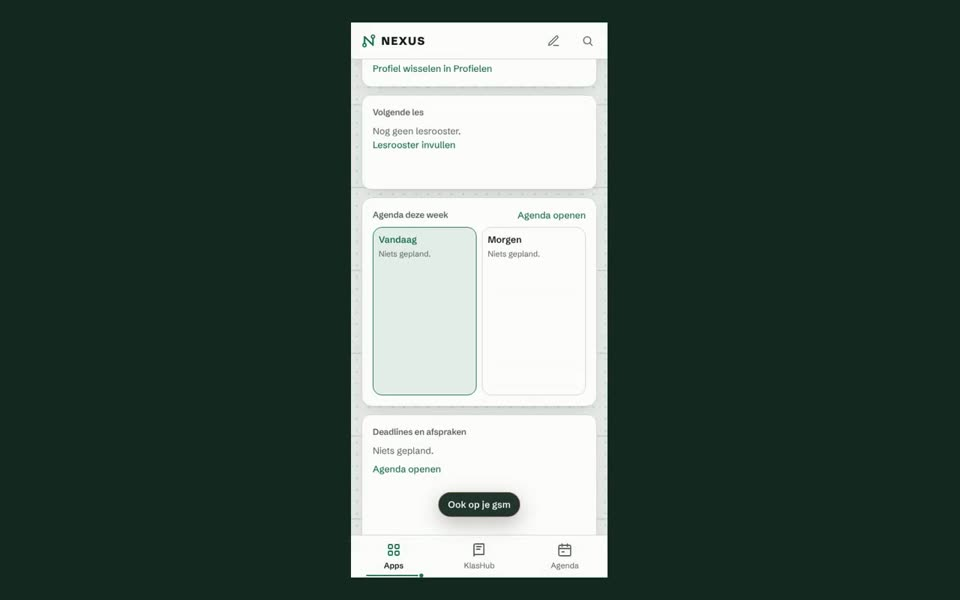
Op een smal scherm wordt NEXUS een gsm-app: een kop met zoeken en snel vastleggen, het dashboard
in één kolom, apps in een raster per groep, en tabbladen onderaan.

### 11. Afvinken met je duim
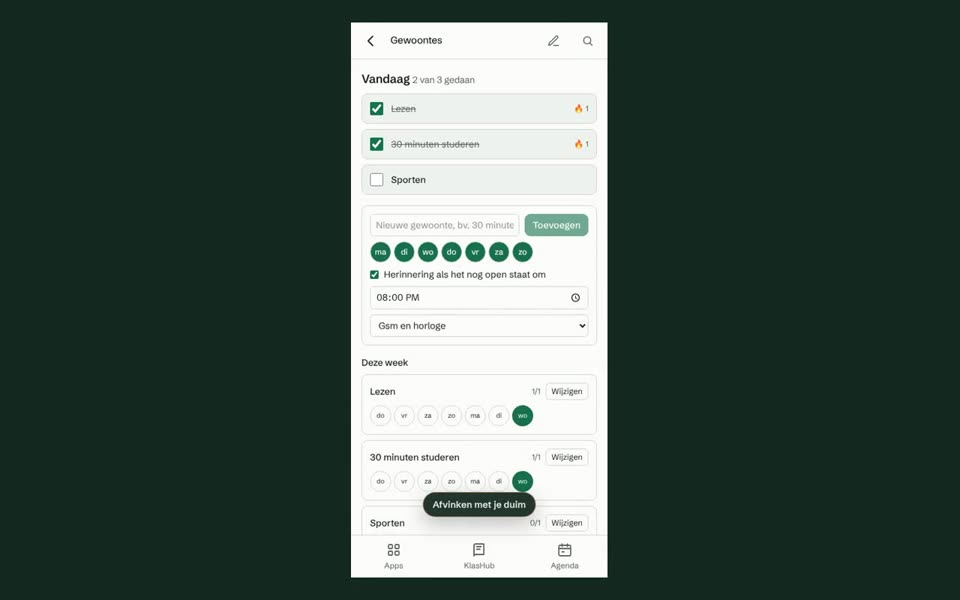
Dezelfde apps, één scherm tegelijk. NEXUS werkt ook offline en installeer je als app.

## Wat er de laatste dagen bijkwam

Je lessen in Google Agenda · Wat moet ik halen op mijn volgende examen? · Je gamingstatus op Discord ·
Focusmuziek met Spotify · Taken automatisch inplannen · Mijn dag bovenaan je dashboard · Favorieten
in de taakbalk · Rustige, vloeiende beweging · Een donkergroen app-icoon · Een veiligere database ·
De klok loopt gelijk · Geen zijbalk meer en een nieuw NEXUS-teken · Een nieuw uiterlijk: de werkbank.

De volledige lijst staat in `apps/web/src/about/entries/` (één bestand per wijziging) en, voor de oudere regels, in `apps/web/src/about/changelog.ts`.

## Hoe het in elkaar zit (kort)

- **Lokaal eerst**: elk apparaat bewaart alles in IndexedDB of localStorage en werkt offline;
  wijzigingen gaan via een wachtrij naar Supabase.
- **Beveiliging**: row-level security op elke tabel; meldingen tussen apparaten (NEXUS Connect) en
  berichten zijn end-to-end versleuteld; NEXUS AI voert niets uit zonder toestemming per actie.
- **Lagen**: pure logica en types in `packages/core` (met unit-tests), de interface in `apps/web`,
  serverfuncties in `api/`, databaseschema in `supabase/`.
- **Testen**: typecheck, bijna 1000 unit-tests (web en core), databasetests op Postgres, en
  Playwright-rooktests met axe-toegankelijkheidscontrole op desktop en gsm.
